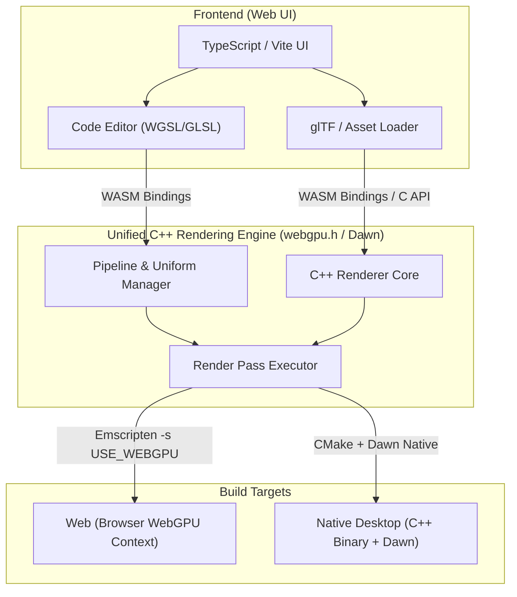
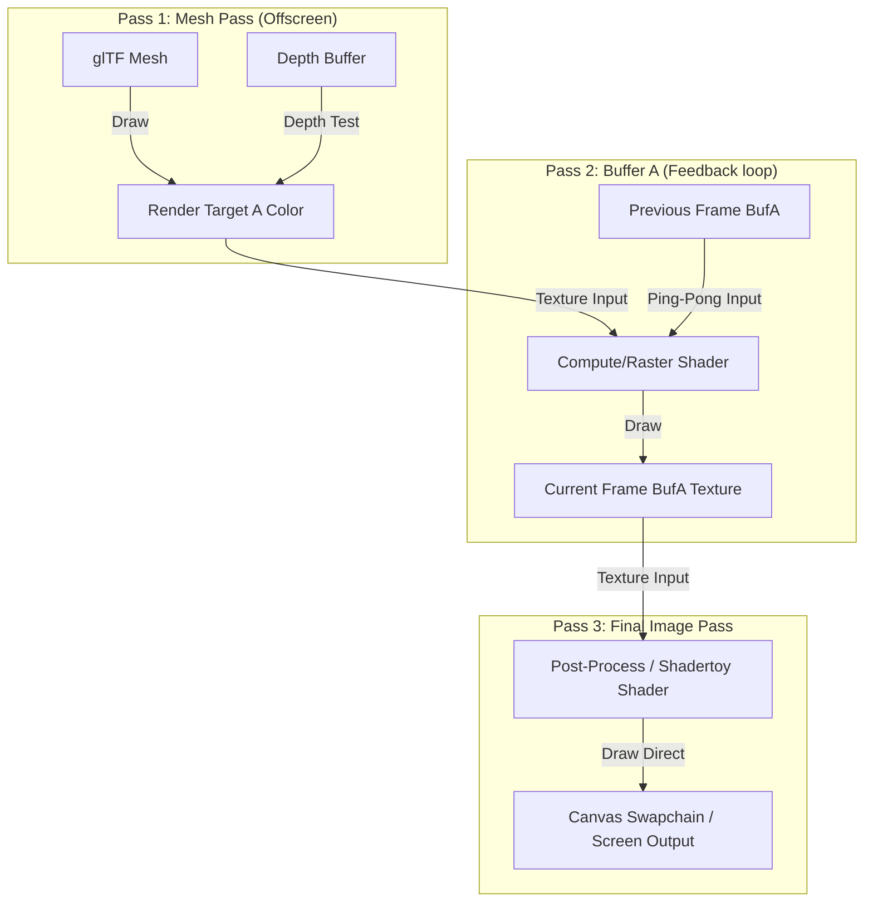

# Technical Design & Planning Document - Cross-Platform WebGPU Shader, Mesh & ML Playground

## 1. Problem Description (Business & Developer Context)

The modern real-time computer graphics and machine learning landscapes are undergoing a major shift. WebGL is being phased out in favor of **WebGPU**, a low-level, high-performance API that maps much more closely to modern graphics hardware (Vulkan, Metal, Direct3D 12). 

While WebGPU unlocks raw GPU access and first-class **Compute Shaders** on the web, it introduces several friction points for developers, researchers, and browser engine developers (such as the Google Dawn team):

1. **A Steep Learning Curve & Language Transition**: Developers transitioning from WebGL (GLSL) to WebGPU (WGSL) lack intuitive playgrounds. The inability to copy-paste GLSL code blocks directly to learn how they map to WGSL creates high friction.
2. **Missing Geometry Pipeline Testing**: Industry standard tools like Shadertoy are strictly limited to screen-space fragment shaders (fullscreen quads) and do not support importing custom 3D models (glTF/OBJ) or custom vertex shader displacements.
3. **High-Performance Compute & ML Testing Barriers**: WebGPU compute pipelines are opening up WebAssembly-based Machine Learning (ML) inference and physical simulations on the web. However, developers lack lightweight tools to quickly test custom `@compute` kernels, storage buffer allocations, and float array transformations visually.
4. **The Cross-Platform Driver Debugging Gap**: Browser engineering teams (like the Dawn engine team) face challenges debugging driver bugs, compiler bugs (Tint), or platform-specific regressions. Testing WebGPU behavior requires either running heavy browser compilation suites or writing isolated native test cases. There is no lightweight tool that shares a single C++ rendering core capable of compiling natively (for bare-metal GPU profiling and CLI pixel-diff testing) and compiling to WebAssembly (for interactive web debugging).

### The Solution
We are building a **Cross-Platform Shader, Mesh & Compute Studio**. By sharing a unified C++ rendering core compiled natively (via Dawn) and to the browser (via WASM), this playground solves these gaps. It provides a visual bridge between GLSL and WGSL, supports custom geometry loading, simplifies compute/ML storage buffer validation, and serves as a headless profiling harness for Dawn developers to isolate driver divergences.

---

## 2. Technical Implementation Summary

To make this project work, we are building **one core graphics program** that can run in two completely different environments: directly on your computer's desktop (Windows, Mac, Linux) and inside a web browser. 

Here is how the main parts are split and how they fit together:

### The Major Components

1. **The Shared Rendering Core (The Engine)**:
   This is the central drawing engine written in C++. You can think of it as a digital painter. It takes "instructions" (custom shaders written by the user) and "canvases" (3D models and image textures) and tells the computer's graphics card exactly how to draw them. Because it uses a universal C++ interface, it does not care whether it is running on a Mac, Windows PC, or inside a web page.
2. **The Desktop Wrapper (The Native CLI)**:
   This wraps the shared engine so it can run directly on your computer's operating system. It opens a standard application window and lets you load models and shaders directly from local files. It also has a command-line mode: you can tell it to render a scene behind the scenes, take a pixel-perfect snapshot, and save it as an image file on your hard drive. This is designed for browser developers who need to run automated driver tests.
3. **The Web Interface (The Browser App)**:
   This is the web page that users interact with. It contains a code editor (where you write and edit shaders), menus (where you upload models or select preloaded shapes), a console (which highlights code errors), and a canvas (where you see the real-time visual output). We translate the shared C++ engine into a format the browser understands (WebAssembly) so it can run inside the web page.
4. **The Translator (GLSL to WGSL Compiler)**:
   Web browsers only understand a new shader language called WGSL. To let users paste old GLSL shaders (from sites like Shadertoy), we include a translator in the web app. When you paste GLSL code, the web page translates it into WGSL in the browser before sending it to the shared engine. The desktop wrapper does this translation natively on your computer.

### How They Fit Together & Fit the Ecosystem

When you are editing a shader in the Web Interface, you can save your project. The app bundles your code, settings, textures, and 3D models into a single file (called a `.swgscene` file, which is just a ZIP folder). 

You can email this file to a colleague, upload it to the web app, or run it directly in the Desktop program. Because both the web app and the desktop app run the exact same rendering engine, the visual output should look identical. 

If they look different, a developer has found a bug in either the browser's graphics systems or the computer's drivers. This makes the playground a powerful tool in the WebGPU ecosystem—it is both a learning tool for web developers and a diagnostics tool for browser engineering teams.

---

## 3. Architectural Diagrams

### 1. High-Level Target Compilation Flow
Shows how the unified C++ WebGPU Core engine target builds compile to both browser (WASM) and Native desktop contexts.



### 2. Multi-Pass Rendering Flow (Vulkan/WebGPU Concept)
Shows how shaders accumulate frames via feedback loops (Ping-Pong buffers) and how meshes are drawn offscreen before final image mapping.



---

## 4. Input & Output Resource Specifications

To ensure WebGPU and Vulkan backend alignment, this section defines the exact memory layouts, buffer sizes, and bind group structures for all pipeline resources.

### 1. Geometry Input Layouts (Mesh Buffers)
For 3D mesh rendering, vertex attributes are fed via an interleaved Vertex Buffer:

| Attribute | Location | Format | Size (Bytes) | Description |
| :--- | :--- | :--- | :--- | :--- |
| `position` | 0 | `VertexFormat::Float32x3` | 12 | Vertex coordinates (X, Y, Z) |
| `normal` | 1 | `VertexFormat::Float32x3` | 12 | Surface normal vector |
| `uv` | 2 | `VertexFormat::Float32x2` | 8 | Texture coordinate (U, V) |
| `tangent` | 3 | `VertexFormat::Float32x4` | 16 | Tangent vector (with sign direction) |

* **Total Vertex Stride**: 48 bytes (aligned to 4-byte boundaries).
* **Index Buffer**: `IndexFormat::Uint32`.

### 2. Bind Group Layouts (Shaders & Uniforms)

#### Bind Group 0: Frame & Camera Uniforms
This bind group contains global parameters updated per frame.

```wgsl
struct ShadertoyUniforms {
    // std140 packing: iResolution (12B) + iTime (4B) = 16B (aligned)
    iResolution : vec3<f32>,
    iTime       : f32,
    
    // std140 packing: iTimeDelta (4B) + iFrameRate (4B) + iFrame (4B) + pad0 (4B) = 16B (aligned)
    iTimeDelta  : f32,
    iFrameRate  : f32,
    iFrame      : i32,
    pad0        : u32,
    
    iMouse      : vec4<f32>,
    iDate       : vec4<f32>,
};

struct CameraUniforms {
    uViewProj       : mat4x4<f32>,
    uModel          : mat4x4<f32>,
    uNormalMatrix   : mat4x4<f32>,
    uCameraPosition : vec3<f32>,
    padding         : f32,     // Padding to align to 16-byte boundary
};

@group(0) @binding(0) var<uniform> u_shadertoy : ShadertoyUniforms;
@group(0) @binding(1) var<uniform> u_camera    : CameraUniforms;
```

#### Bind Group 1: Samplers & Channel Textures (Pass Resources)
Binds the static texture assets, buffer feedback loops, or mesh offscreen passes.

##### WGSL Shader Syntax
In WGSL, you must **explicitly declare** the sampler and textures at the top of your shader file:
```wgsl
@group(1) @binding(0) var s_sampler  : sampler;
@group(1) @binding(1) var iChannel0 : texture_2d<f32>;
@group(1) @binding(2) var iChannel1 : texture_2d<f32>;
@group(1) @binding(3) var iChannel2 : texture_2d<f32>;
@group(1) @binding(4) var iChannel3 : texture_2d<f32>;

// To sample:
let color = textureSample(iChannel0, s_sampler, uv);
```

##### GLSL Shader Syntax
In GLSL, you **do NOT need to declare** `iChannel0..3` or `s_sampler`. The engine automatically injects the bindings at compile time. You can write your shader exactly like you would on Shadertoy:
```glsl
// To sample:
vec4 color = texture(iChannel0, uv);
```
Under the hood, the engine prepends these declarations to your GLSL code:
```glsl
layout(set = 1, binding = 0) uniform sampler s_sampler;
layout(set = 1, binding = 1) uniform texture2D iChannel0;
layout(set = 1, binding = 2) uniform texture2D iChannel1;
layout(set = 1, binding = 3) uniform texture2D iChannel2;
layout(set = 1, binding = 4) uniform texture2D iChannel3;
```

#### Bind Group 2: Storage Buffers (Compute / ML Passes)
Binds read-write memory buffers for compute shader simulations and ML model weights.

```wgsl
struct Particle {
    position : vec4<f32>,
    velocity : vec4<f32>,
};

@group(2) @binding(0) var<storage, read_write> sParticles : array<Particle>;
```

### 3. Pipeline Output Resources (Render Targets)

#### Offscreen Textures (`Render Target A..D`)
Used for intermediate passes (mesh renders, buffer pipelines, post-process loops).
* **Format**: `wgpu::TextureFormat::RGBA8Unorm` or `RGBA16Float` (HDR).
* **Usage**: `TextureUsage::RenderAttachment | TextureUsage::TextureBinding | TextureUsage::CopySrc`.
* **Double Buffering (Ping-Pong)**: Allocated in read/write pairs; active references swap at the end of the pass.

#### Depth/Stencil Buffer
Required for the offscreen mesh pass.
* **Format**: `wgpu::TextureFormat::Depth24PlusStencil8`.

#### Final Canvas Swapchain
* **Format**: Browser-preferred format (typically `wgpu::TextureFormat::BGRA8Unorm`).

#### Staging Buffer (Screenshot / Headless Staging)
* **Staging Buffer**: CPU-mapped buffer with `wgpu::BufferUsage::MapRead | wgpu::BufferUsage::CopyDst` to extract frames in headless CLI runs.

### 4. Offscreen Pass Buffers (Buffer A..D) & Feedback Loops

To support complex visual effects, simulations, and multi-stage post-processing, the studio provides four offscreen render passes: **Buffer A**, **Buffer B**, **Buffer C**, and **Buffer D**, in addition to the final **Image** (screen) pass.

#### What are Buffers A, B, C, D?
Each buffer is an offscreen texture (render target) with the same resolution as the viewport (unless a custom size is specified in the scene manifest). 
* When a buffer is **enabled**, the engine runs its fragment shader and renders the output into that buffer's texture instead of the screen.
* The passes are executed sequentially in every frame: 
  $$\text{Buffer A} \rightarrow \text{Buffer B} \rightarrow \text{Buffer C} \rightarrow \text{Buffer D} \rightarrow \text{Image}$$

#### How to Use Buffers as Inputs (`iChannel0..3`)
Any pass can bind the output of any *previously executed* buffer (or even its own output) to one of its input slots (`iChannel0..3`).
* **Multi-Pass Pipeline Example (e.g., Bloom/Blur)**:
  1. **Buffer A** renders the 3D scene.
  2. **Buffer B** reads `Buffer A` as `iChannel0` and performs a horizontal blur.
  3. **Buffer C** reads `Buffer B` as `iChannel0` and performs a vertical blur.
  4. **Image** reads `Buffer A` (original scene) as `iChannel0` and `Buffer C` (blurred highlight) as `iChannel1`, combining them to produce a bloom effect.

#### How Feedback Loops Work (Ping-Pong Buffering)
If a buffer binds **itself** as an input (e.g., `Buffer A` reads `Buffer A` as `iChannel0`), it creates a **temporal feedback loop**. This is used for:
* Fluid simulations and cellular automata.
* Persistent particle physics.
* Motion blur, light trails, and temporal anti-aliasing.

To prevent WebGPU from reading and writing to the same texture simultaneously (which is a validation error), the engine allocates a **Ping-Pong pair** of textures for each buffer:
1. **Read Texture**: Holds the output of the *previous* frame.
2. **Write Texture**: The active render target for the *current* frame.

During execution:
* The shader reads historical data from the **Read Texture** via `iChannelX`.
* The shader writes new data to the **Write Texture**.
* At the end of the pass, the engine **swaps** the read and write textures so the newly rendered frame becomes the history for the next frame.

#### WGSL & GLSL Shader Examples

##### WGSL Feedback Example (Accumulation)
```wgsl
// In Buffer A: Accumulate color over time
@group(1) @binding(1) var iChannel0 : texture_2d<f32>; // Bound to BufferA (self)
@group(1) @binding(0) var s_sampler : sampler;

@fragment
fn main(input : VertexOutput) -> @location(0) vec4<f32> {
    let uv = input.uv;
    
    // Read the previous frame's color
    let prevColor = textureSample(iChannel0, s_sampler, uv);
    
    // Compute current frame's color (e.g. a moving circle)
    let dist = distance(uv, vec2<f32>(0.5 + 0.2 * sin(u_shadertoy.iTime), 0.5));
    let currentMask = select(0.0, 1.0, dist < 0.05);
    let currentColor = vec4<f32>(currentMask, 0.0, 0.0, 1.0);
    
    // Blend them (90% history, 10% new frame) to create a trail effect
    return mix(prevColor, currentColor, 0.1);
}
```

##### GLSL Feedback Example (Accumulation)
```glsl
// In Buffer A: Accumulate color over time
// iChannel0 is bound to Buffer A (self)
void mainImage(out vec4 fragColor, in vec2 fragCoord) {
    vec2 uv = fragCoord / iResolution.xy;
    
    // Read previous frame
    vec4 prevColor = texture(iChannel0, uv);
    
    // Compute current frame
    float dist = distance(uv, vec2(0.5 + 0.2 * sin(iTime), 0.5));
    vec4 currentColor = vec4(dist < 0.05 ? 1.0 : 0.0, 0.0, 0.0, 1.0);
    
    // Blend
    fragColor = mix(prevColor, currentColor, 0.1);
}
```

#### Texture Coordinates & Y-Inversion (GLSL vs WGSL)

WebGPU uses a **Y-down** texture coordinate system (where `uv = (0,0)` is the top-left of the texture). This differs from OpenGL and Shadertoy, which use a **Y-up** coordinate system (where `uv = (0,0)` is the bottom-left).

To ensure high compatibility with Shadertoy shaders while preserving WebGPU's native performance, the engine handles texture coordinates differently depending on the shader language:

##### 1. GLSL Shader Behavior (Auto-Flipped)
The GLSL compatibility header automatically flips the Y coordinate in the `texture()` macro. This makes texture sampling behave exactly like it does on Shadertoy:
* **Offscreen Buffers (Buffer A..D)** and **external images** are sampled right-side up.
* **Code Example**:
  ```glsl
  void mainImage(out vec4 fragColor, in vec2 fragCoord) {
      vec2 uv = fragCoord / iResolution.xy;
      // The macro automatically translates this to sample with (uv.x, 1.0 - uv.y)
      vec4 color = texture(iChannel0, uv);
      fragColor = color;
  }
  ```

##### 2. WGSL Shader Behavior (Native WebGPU Y-Down)
WGSL shaders compile directly to WebGPU without a compatibility macro wrapper. They follow native WebGPU conventions:
* **Offscreen Buffers (Buffer A..D)** will appear **vertically inverted** when sampled with the standard screen UVs.
* **To correct the inversion in WGSL**, you must manually flip the Y coordinate:
  ```wgsl
  @group(1) @binding(1) var iChannel0 : texture_2d<f32>;
  @group(1) @binding(0) var s_sampler : sampler;

  @fragment
  fn main(input : VertexOutput) -> @location(0) vec4<f32> {
      let uv = input.uv;
      // Manually flip Y for WebGPU offscreen textures
      let flippedUV = vec2<f32>(uv.x, 1.0 - uv.y);
      let color = textureSample(iChannel0, s_sampler, flippedUV);
      return color;
  }
  ```

---

## 5. Alternatives Considered & Ruled Out

During the technical planning process, we evaluated several alternative designs and ruled them out due to specific trade-offs:

### 1. A Pure JavaScript/TypeScript Engine (WebGL or WebGPU-only)
* **Alternative**: Build the shader playground entirely in TypeScript (using a library like Three.js, Babylon.js, or raw browser WebGPU APIs) without any C++ core.
* **Why Ruled Out**: While much simpler to develop, this would completely exclude the native desktop compile target. A native C++ target is a critical requirement for Google Dawn engine engineers, who need to run bare-metal GPU benchmarks, measure raw clock speeds, and run headless test harnesses outside the browser's overhead to isolate driver bugs.

### 2. Compiling the Tint Compiler into WebAssembly (WASM)
* **Alternative**: Compile Google's C++ Tint shader compiler inside our WASM core engine module to translate GLSL to WGSL directly inside the C++ runtime on the web.
* **Why Ruled Out**: Compiling the full C++ Tint translator into WebAssembly introduces massive binary bloat (adding $>12\text{MB}$ to the WASM file) and severely slows down initial web page loading. We resolved this by using a split-compiler strategy: the web frontend uses lightweight WebAssembly-compiled NPM packages (`@webgpu/glslang` and `twgsl`) running client-side in JavaScript to translate GLSL before sending the clean WGSL code to the C++ core. This keeps our core engine WASM module under $1\text{MB}$.

### 3. Exposing Raw WASM Memory Pointers (`uintptr_t`) for Asset Uploads
* **Alternative**: Expose raw C++ memory pointers to JavaScript. JavaScript would write model vertices and texture pixel arrays directly into the WASM heap at these addresses.
* **Why Ruled Out**: High stability risk. As WebAssembly heap memory grows dynamically to accommodate larger meshes or images, the underlying memory buffer is reallocated, which immediately invalidates and detaches raw pointers in JavaScript. This leads to segmentation faults and browser tab crashes. We standardise instead on Embind (`emscripten::val`) typed-array parameters, which copy data safely and handle heap growth transparently.

### 4. Full glTF PBR Material Rendering & Light Editors
* **Alternative**: Build a full Physically Based Rendering (PBR) engine from scratch to support all default glTF materials, textures, skeletons, and light hierarchies.
* **Why Ruled Out**: Major scope creep. Writing a complete PBR graphics pipeline from scratch in raw C++ WebGPU is an enormous task that would distract from the main goals of testing shaders, custom compute loops, and benchmarking. We deferred full material parsing. The model loader acts as a pure geometry parser (loading raw vertices and normals), and we provide a simple flat debug shader. The user is responsible for writing their own custom vertex and fragment shaders to shade the mesh.

### 5. Implicit Bind Group Mapping in `scene.json`
* **Alternative**: Create a fixed default bind group mapping (e.g. uniforms are always in Group 0, textures in Group 1) to simplify the JSON scene manifest.
* **Why Ruled Out**: Too restrictive. In WebGPU, shaders define custom binding structures. Forcing implicit layouts would prevent users from copying complex shaders from external projects without rewriting their `@group` and `@binding` parameters. We standardized on explicit `group_id` and `binding_id` mappings in the schema for maximum pipeline configuration flexibility.

### 6. Offscreen Canvas Web Workers initially
* **Alternative**: Run the WebAssembly loop inside a background Web Worker from day one to prevent compilation and asset loads from blocking the browser's main thread.
* **Why Ruled Out**: Deferred to a future optimization phase. Running WebGPU inside workers requires OffscreenCanvas, which complicates bootstrapping and makes initial debugging harder. We will build main-thread loops first and refactor if performance demands it.

---

## 6. Detailed Technical Specifications & Risk Mitigations

This section resolves the core specifications to prevent build, execution, and architectural blockers.

### 1. Platform Abstraction Layer (PAL) Design
To resolve API divergences between standard C headers (`webgpu.h` used by Emscripten) and C++ wrapper structures (`webgpu_cpp.h` used by Dawn), we enforce a platform abstraction layer:
* PLATFORM backends compiled via folders: `src/platform/web/` and `src/platform/native/`.
* Base abstraction header `src/core/graphics_context.h` defines all bootstrap logic using platform-agnostic WGPU pointer calls.
* **C++ Virtual Functions Specification**:
  ```cpp
  #ifndef GRAPHICS_CONTEXT_H
  #define GRAPHICS_CONTEXT_H

  #include <webgpu/webgpu.h>
  #include <string>

  class GraphicsContext {
  public:
      virtual ~GraphicsContext() = default;

      // Lifecycle Initializers
      virtual bool Init() = 0;
      virtual bool CreateSwapChain(uint32_t width, uint32_t height) = 0;
      
      // Context Getters
      virtual WGPUDevice GetDevice() const = 0;
      virtual WGPUQueue GetQueue() const = 0;
      virtual WGPUSurface GetSurface() const = 0;
      virtual WGPUTextureFormat GetSwapChainFormat() const = 0;

      // Frame Execution Hooks
      virtual WGPUTextureView GetCurrentSwapChainView() = 0;
      virtual void Present() = 0;
      
      // Screen Properties
      virtual uint32_t GetWidth() const = 0;
      virtual uint32_t GetHeight() const = 0;
  };

  #endif // GRAPHICS_CONTEXT_H
  ```

### 2. Standardized Shader Compiling Toolchain (100% Web/Native Parity)
Both targets compile through the **exact same Khronos glslang and Google Tint compilers**:
* **Web (Browser)**:
  - React frontend compiles GLSL input to SPIR-V using **`@webgpu/glslang`** (Khronos WASM).
  - The compiler translates SPIR-V directly to WGSL using **`twgsl`** (Google Tint WASM).
  - The generated WGSL is sent to the C++ WASM module, keeping the engine core extremely lightweight.
* **Native C++ Desktop**:
  - C++ native application links Dawn's integrated `glslang` and Tint libraries to compile files on the fly.

### 3. WASM Heap Growth & Memory Upload Model
* Memory-safe typed-array copies are passed using Embind `emscripten::val` vectors (e.g. `load_mesh_data(...)`).
* C++ extracts data directly using Emscripten views, which handles heap relocation safely and transparently.
* **Embind Signatures Specification**:
  ```cpp
  #include <emscripten/bind.h>
  #include <emscripten/val.h>
  #include <string>

  class EngineCore {
  public:
      EngineCore(std::string canvas_selector);
      bool Initialize();
      bool UpdateShader(const std::string& pass_name, const std::string& wgsl_source, const std::string& language);
      void LoadMeshData(const emscripten::val& vertices_array, const emscripten::val& indices_array);
      void LoadTextureData(int channel, const emscripten::val& pixels_array, int width, int height);
      void SetUniforms(float time, float time_delta, float frame_rate, int frame, float mouse_x, float mouse_y, float mouse_z, float mouse_w);
      void Tick(double timestamp);
      void Resize(int width, int height);
  };

  EMSCRIPTEN_BINDINGS(engine_bindings) {
      emscripten::class_<EngineCore>("EngineCore")
          .constructor<std::string>()
          .function("initialize", &EngineCore::Initialize)
          .function("update_shader", &EngineCore::UpdateShader)
          .function("load_mesh_data", &EngineCore::LoadMeshData)
          .function("load_texture_data", &EngineCore::LoadTextureData)
          .function("set_uniforms", &EngineCore::SetUniforms)
          .function("tick", &EngineCore::Tick)
          .function("resize", &EngineCore::Resize);
  }
  ```

### 4. Uniform Alignment (std140) Safety
* Struct definitions contain explicit padding floats to guarantee WGSL std140 16-byte vector alignments.
* We enforce compile-time **`static_assert`** statements on both the size and key offsets of C++ structs to flag layout bugs immediately.
* **C++ Uniform Struct Layouts**:
  ```cpp
  struct ShadertoyUniforms {
      float iResolution[3]; // vec3
      float iTime;
      float iTimeDelta;
      float iFrameRate;
      int32_t iFrame;
      uint32_t pad0;        // Explicit 4-byte padding to align iMouse to 16-byte boundary
      float iMouse[4];      // vec4
      float iDate[4];       // vec4
  };
  static_assert(sizeof(ShadertoyUniforms) == 64, "ShadertoyUniforms size must be 64 bytes");
  static_assert(offsetof(ShadertoyUniforms, iMouse) == 32, "ShadertoyUniforms.iMouse offset must be 32 bytes");

  struct CameraUniforms {
      float uViewProj[16];       // mat4x4
      float uModel[16];          // mat4x4
      float uNormalMatrix[16];   // mat4x4
      float uCameraPosition[3];  // vec3
      float padding;              // Explicit 4-byte padding to align struct to 16-bytes
  };
  static_assert(sizeof(CameraUniforms) == 208, "CameraUniforms size must be 208 bytes");
  static_assert(offsetof(CameraUniforms, uCameraPosition) == 192, "CameraUniforms.uCameraPosition offset must be 192 bytes");
  ```

### 5. Cyclic Rendering Dependency (Ping-Pong Buffer Deadlocks)
* Target passes define `"ping_pong": true` inside the `scene.json` schema.
* The texture manager dynamically allocates dual textures and swaps references each frame, preventing WebGPU read/write validation errors.

### 6. Optional GPU Timestamp Queries (Security Mitigation)
* **The Vulnerability**: WebGPU GPU timestamp-query features are blocked by default in browsers to prevent timing attacks (e.g., Spectre). Requesting this feature unconditionally during device creation will crash adapter/device initialization.
* **Feature Guarding**:
  - The platform context queries the adapter capability before requesting device creation:
  ```cpp
  std::vector<wgpu::FeatureName> requiredFeatures;
  if (adapter.HasFeature(wgpu::FeatureName::TimestampQuery)) {
      requiredFeatures.push_back(wgpu::FeatureName::TimestampQuery);
      m_timestamps_supported = true;
  } else {
      m_timestamps_supported = false;
  }
  ```
  - If `m_timestamps_supported` is false, GPU profiling metrics are disabled, and the engine falls back to standard CPU-side timings (`performance.now()` on web, `std::chrono` on native) to measure frame loop intervals.

### 7. Asynchronous Pipeline Compilation (Jank Reduction)
* **The Problem**: Compiling rendering/compute pipelines synchronously during code editing on the browser's main thread causes visual freezes (jank) for up to several hundred milliseconds.
* **Async Swapping**:
  - We use asynchronous pipeline creation (`wgpuDeviceCreateRenderPipelineAsync` / `wgpuDeviceCreateComputePipelineAsync`).
  - While compiling runs in the background, the pipeline manager **continues rendering using the last successfully built pipeline**.
  - Once the async compiler callback resolves, the engine swaps in the new pipeline, resulting in stutter-free editor hot-reloading.

### 8. Image Color Space Configuration (sRGB vs. Linear)
* **The Problem**: WebGPU requires explicit color space formatting. Loading diffuse/base color textures as linear colors makes them appear washed out, while loading normal maps as sRGB formats breaks normal-vector math equations.
* **Format Flags**:
  - We update the `scene.json` texture binding schema with a `"format"` parameter specifying `"srgb"`, `"linear"`, or `"hdr"`.
  - The C++ texture manager maps these flags to the appropriate WebGPU textures:
    - `"srgb"` $\rightarrow$ `wgpu::TextureFormat::RGBA8UnormSrgb` (Hardware gamma-corrected).
    - `"linear"` $\rightarrow$ `wgpu::TextureFormat::RGBA8Unorm` (Linear calculation).
    - `"hdr"` $\rightarrow$ `wgpu::TextureFormat::RGBA16Float` (High dynamic range).

### 9. Web UI ZIP Decompression Constraints
* **The Problem**: Decompressing large `.swgscene` files containing dense 3D models or multiple textures using JSZip on the main browser thread can freeze the event loop or crash the browser tab.
* **UI Safeguards**:
  - The Vite frontend enforces a **50MB file size limit** on dropped scenes.
  - Large zip archives trigger a loading overlay with a progress indicator, keeping the browser window active, or delegate extraction tasks to a background Web Worker.

### 10. `scene.json` Schema Specification
The manifest describes the rendering pass sequence, uniforms, and resources mappings.

```json
{
  "$schema": "http://json-schema.org/draft-07/schema#",
  "title": "SceneManifest",
  "type": "object",
  "properties": {
    "scene_name": { "type": "string" },
    "camera": {
      "type": "object",
      "properties": {
        "position": { "type": "array", "items": { "type": "number" }, "minItems": 3, "maxItems": 3 },
        "target": { "type": "array", "items": { "type": "number" }, "minItems": 3, "maxItems": 3 },
        "fov": { "type": "number" }
      },
      "required": ["position", "target"]
    },
    "passes": {
      "type": "array",
      "items": {
        "type": "object",
        "properties": {
          "name": { "type": "string" },
          "type": { "type": "string", "enum": ["compute", "mesh", "raster"] },
          "shader": { "type": "string", "description": "Relative path to shader file" },
          "shader_language": { "type": "string", "enum": ["wgsl", "glsl"], "description": "Specifies compiling parser context" },
          "render_target": { "type": "string", "description": "Name of output texture, or 'screen'" },
          "ping_pong": { "type": "boolean", "description": "Enable double-buffering for feedback loops" },
          "render_target_size": {
            "type": "object",
            "properties": {
              "width": { "type": "integer" },
              "height": { "type": "integer" }
            },
            "description": "Optional fixed sizing. If omitted, target defaults dynamically to viewport resolution."
          },
          "bindings": {
            "type": "array",
            "items": {
              "type": "object",
              "properties": {
                "group_id": { "type": "integer", "description": "Explicit WebGPU @group index" },
                "binding_id": { "type": "integer", "description": "Explicit WebGPU @binding index" },
                "type": { "type": "string", "enum": ["uniform", "sampler", "texture2d", "storage"] },
                "source": { "type": "string", "description": "Maps to a render target name, preset name, or local asset path" },
                "format": { "type": "string", "enum": ["srgb", "linear", "hdr"], "description": "Format for color space mapping" }
              },
              "required": ["group_id", "binding_id", "type", "source"]
            }
          }
        },
        "required": ["name", "type", "shader", "shader_language", "render_target"]
      }
    }
  },
  "required": ["scene_name", "passes"]
}
```

### 11. Shadertoy GLSL Compatibility Wrapper Template
* **Injected Template Specification**:
  ```cpp
  #ifndef SHADERTOY_COMPAT_H
  #define SHADERTOY_COMPAT_H
  #include <string>

  const std::string GLSL_SHADERTOY_HEADER = R"(
  #version 450
  layout(location = 0) out vec4 outColor;
  layout(location = 0) in vec2 uv; // Input UV from fullscreen vertex shader

  layout(set = 0, binding = 0) uniform ShadertoyUniforms {
      vec3 iResolution;
      float iTime;
      float iTimeDelta;
      float iFrameRate;
      int iFrame;
      vec4 iMouse;
      vec4 iDate;
  };

  layout(set = 1, binding = 0) uniform sampler s_sampler;
  layout(set = 1, binding = 1) uniform texture2D iChannel0;
  layout(set = 1, binding = 2) uniform texture2D iChannel1;
  layout(set = 1, binding = 3) uniform texture2D iChannel2;
  layout(set = 1, binding = 4) uniform texture2D iChannel3;

  // Macro mapping WebGL-style sampler2D access to Vulkan/WebGPU separate texture/sampler bindings
  #define texture(tex, uv_coord) texture(sampler2D(tex, s_sampler), uv_coord)

  // User entry point declaration
  void mainImage(out vec4 fragColor, in vec2 fragCoord);

  void main() {
      vec2 fragCoord = uv * iResolution.xy;
      vec4 fragColor;
      mainImage(fragColor, fragCoord);
      outColor = fragColor;
  }
  )";

  #endif // SHADERTOY_COMPAT_H
  ```

---

## 7. Implementation Plan (File Enumeration & Rationales)

This section enumerates every configuration, source, header, scripting, and layout file we will create or modify in our workspace, alongside the specific architectural rationale for each.

### 1. Build & Build Dependency Configuration Files

* **`CMakeLists.txt` (Root)**
  - *Rationale*: Configures the global C++ build workspace. Integrates CMake `FetchContent` to download and build Google Dawn (Commit: `c9694e9f7831f49bbfd6d0277df607d727b3b4f6`) for native desktop builds. Directs Emscripten compiler settings (flags like `-s USE_WEBGPU=1`, `-s WASM=1`, Embind linking) when compiling for WebAssembly.
* **`third_party/CMakeLists.txt`**
  - *Rationale*: Configures sub-build targets for the bundled helper libraries in `/third_party`. Builds header-only loaders as isolated static links to prevent pollute main source spaces.
* **`third_party/miniz/miniz.h` & `third_party/miniz/miniz.c` [NEW]**
  - *Rationale*: Header/source files for `miniz`, a lightweight C ZIP compressor/extractor. Necessary for the C++ native core to read and write `.swgscene` files from disk/RAM without dependencies.
* **`third_party/stb_image/stb_image.h` & `third_party/stb_image/stb_image_impl.cpp` [NEW]**
  - *Rationale*: Custom helper compiling `stb_image` implementation macros. Required for decoding PNG/JPG texture files on the desktop.
* **`third_party/tinyobjloader/tiny_obj_loader.h` & `third_party/tinyobjloader/tiny_obj_loader_impl.cpp` [NEW]**
  - *Rationale*: Compiles OBJ geometry parser. Required for parsing OBJ meshes natively on desktop.
* **`third_party/tinygltf/tiny_gltf.h` & `third_party/tinygltf/tiny_gltf_impl.cpp` [NEW]**
  - *Rationale*: Compiles glTF 2.0 geometry uploader. Extracts raw vertex buffers from GLB/GLTF assets natively.

### 2. Core Rendering Engine (`src/core/`)

* **`src/core/graphics_context.h` [NEW]**
  - *Rationale*: Declares the platform-agnostic graphics context base class interfaces. Provides pure virtual bootstrap hooks (`InitDevice()`, `CreateSwapChain()`, `SubmitQueue()`) returning generic handles (`WGPUDevice`). Enables separation of the web WASM context and native desktop Dawn context. (See Section 6.1 for interface specification).
* **`src/core/renderer.h` & `src/core/renderer.cpp` [NEW]**
  - *Rationale*: Manages the central WebGPU rendering loop, render pipeline setups, and command encoder dispatches. Implements asynchronous pipeline compiles (`wgpuDeviceCreateRenderPipelineAsync`) to prevent UI freezes during editing. Includes strict `static_assert` packing statements to verify std140 uniform compatibility. (See Section 6.4 for C++ uniform structs and static assertions).
* **`src/core/texture_manager.h` & `src/core/texture_manager.cpp` [NEW]**
  - *Rationale*: Manages allocation, formatting, and double-buffering (ping-ponging) of offscreen textures. Reads the `"ping_pong": true` property from `scene.json` and swaps buffer pointers between frames to prevent WebGPU concurrency read/write errors. Automatically maps textures to `RGBA8UnormSrgb` (diffuse colors) or `RGBA8Unorm` (normal/roughness maps) based on the input format flag.
* **`src/core/mesh.h` & `src/core/mesh.cpp` [NEW]**
  - *Rationale*: Defines the vertex attribute layout structure (Position, Normal, UV, Tangent) with a standard 48-byte stride. Creates and updates `wgpu::Buffer` vertex/index buffers.
* **`src/core/scene_loader.h` & `src/core/scene_loader.cpp` [NEW]**
  - *Rationale*: Parses the `scene.json` manifest schema and loads files relative to the project directory. Houses ZIP reading/writing loops using `miniz` to pack and unpack `.swgscene` archives.
* **`src/core/shadertoy_compat.h` [NEW]**
  - *Rationale*: Houses the C++ compatibility shader template wrapper. Prepends uniform structures and samplers/textures bind group layout bindings before compiling pasted GLSL shader inputs. (See Section 6.11 for shader compatibility header template).

### 3. Platform Bootstraps & Bindings (`src/platform/`)

* **`src/platform/web/web_context.h` & `src/platform/web/web_context.cpp` [NEW]**
  - *Rationale*: Concrete platform implementation of `graphics_context` for WebAssembly. Hooks device initialization through Emscripten's canvas API bindings and mounts swapchains directly onto HTML5 `<canvas>` DOM targets.
* **`src/platform/web/bindings.cpp` [NEW]**
  - *Rationale*: Implements Emscripten **Embind** class exports. Registers `EngineCore` and safe typed-array copying functions (`load_mesh_data(...)`) consuming `emscripten::val` typed arrays directly to prevent pointer detachment crashes on WASM heap growth. (See Section 6.3 for Embind exports).
* **`src/platform/native/native_context.h` & `src/platform/native/native_context.cpp` [NEW]**
  - *Rationale*: Concrete platform implementation of `graphics_context` for native desktop. Creates standard GLFW windows, instantiates Dawn-native device contexts, queries adapter for Spectre-safe `TimestampQuery` capabilities, and attaches graphics swapchain handles.
* **`src/platform/native/main.cpp` [NEW]**
  - *Rationale*: CLI program launcher for desktop targets. Parses CLI flags (`--scene`, `--save`, `--dump-buffer`, `--benchmark`), runs GLFW execution window loops, renders final Dear ImGui debug overlay passes, and dumps buffers/screenshots to disk for automated diff testing.

### 4. Web Application Frontend (`web/`)

* **`web/package.json` & `web/tsconfig.json` [NEW]**
  - *Rationale*: Setup Vite dev environments. Installs dependencies: React, TypeScript, CodeMirror code editor, `jszip` (packaging zip archives), `@webgpu/glslang` (GLSL compiling), and `twgsl` (SPIR-V translation).
* **`web/vite.config.ts` [NEW]**
  - *Rationale*: Directs compiling output folders and registers secure HTTP headers (Cross-Origin-Opener-Policy, Cross-Origin-Embedder-Policy) required to unlock multi-threading WebAssembly SharedArrayBuffers.
* **`web/index.html` [NEW]**
  - *Rationale*: Main web template container mounting canvas viewports and loading JS scripts.
* **`web/src/index.css` [NEW]**
  - *Rationale*: Implements the design layout tokens (glassmorphism panels, CSS styling grids, custom dark-mode scrollbars, and neon glow indicators). Fully conforms to Vanilla CSS rules.
* **`web/src/main.tsx` [NEW]**
  - *Rationale*: Mounts the React component hierarchy.
* **`web/src/App.tsx` [NEW]**
  - *Rationale*: The central dashboard layout managing workspaces, compiler updates, and resizing.
* **`web/src/components/Viewport.tsx` [NEW]**
  - *Rationale*: Manages the WebGL/WebGPU HTML5 canvas, instantiates the WASM `EngineCore` class, and schedules animation rendering cycles.
* **`web/src/components/Editor.tsx` [NEW]**
  - *Rationale*: CodeMirror editor panel with syntax highlighting for WGSL/GLSL, coordinate cursor indicators, and compile hooks (`Alt + Enter`). Underlines compilation diagnostics directly on code lines.
* **`web/src/components/Diagnostics.tsx` [NEW]**
  - *Rationale*: Collapsible panel showing structured output logs from `getCompilationInfo()`. Clicking an entry scrolls the CodeMirror editor to the exact line/column.
* **`web/src/components/AssetManager.tsx` [NEW]**
  - *Rationale*: Visual panel for presets selections (e.g. Quad, Sphere, Cube, Teapot meshes, Checkerboard/Noise textures) and drag-and-drop custom imports.
* **`web/src/utils/compiler.ts` [NEW]**
  - *Rationale*: Coordinates browser-side GLSL transpilation. Feeds code strings through `@webgpu/glslang` to produce SPIR-V and then `twgsl` to output clean WGSL strings before passing them to WASM.
* **`web/src/utils/indexed_db.ts` [NEW]**
  - *Rationale*: Implements local client caching of heavy model array buffers and texture binary blobs using IndexedDB.
* **`web/src/utils/scene_serializer.ts` [NEW]**
  - *Rationale*: Packages active editor files, parameters, and IndexedDB assets into `.swgscene` files using JSZip, and handles decompression of dropped scenes in Web Workers.
* **`web/scripts/diff_buffers.py` [NEW]**
  - *Rationale*: Python script mapping storage buffer data dumped from the native binary and web client to floats, running element-by-element numerical verification with $\epsilon = 10^{-5}$ tolerance.
* **`web/public/assets/` [NEW]**
  - *Rationale*: Holds static preset mesh OBJ files (Quad, Sphere, Cube, Teapot) and PNG noise texture patterns.

### 5. Deployment Configurations

* **`firebase.json` & `.firebaserc` [NEW]**
  - *Rationale*: Directs Google Firebase Hosting deployment. configures HTTP mappings for secure WASM deployment (`application/wasm` MIME type headers) and ensures standard SSL HTTPS configuration for secure browser WebGPU context execution.

---

## 8. Detailed Implementation Phases

### Phase 1: Platform Abstraction Layer (PAL) & C++ Core Setup
* Setup `CMakeLists.txt` for dual target compilation (Native Dawn + Emscripten WASM).
* Create platform abstraction headers (`src/core/graphics_context.h`) and backend bindings (`src/platform/web/` and `src/platform/native/` - with optional `TimestampQuery` checks).
* Implement core WebGPU renderer: device creation, uniform structures (with padding and `static_assert` statements), MVP matrices.
* Implement geometry pipeline for fullscreen quads (the foundation for Shadertoy rendering).

### Phase 2: GLSL Compiler Toolchain & Shadertoy Compatibility
* Web: Integrate `@webgpu/glslang` and `twgsl` NPM packages into the React frontend compiler manager.
* Native C++: Link Dawn's internal glslang + Tint compiler pipelines.
* Build the Shadertoy wrapper header `src/core/shadertoy_compat.h` (emulating `mainImage`, `fragCoord`, `iResolution`, `iTime`, `iMouse`, etc.).
* Wire the compiler pipeline so that GLSL entered by the user is wrapped, compiled to WGSL, and loaded into the C++ core renderer.

### Phase 3: Web UI (TypeScript / React) & Code Editor (Shadertoy Replica)
* **Phase 3.1: Core WGSL Dashboard**
  * Scaffold Vite + React (TypeScript) frontend.
  * Integrate modularized C++ WebAssembly engine with lifecycle memory cleanup and High-DPI (`devicePixelRatio`) rendering.
  * Implement CodeMirror 6 editor with syntax highlighting for WGSL (via Rust extension fallback).
  * Build side-by-side "Source Editor" and "Canvas Viewport" panels.
  * **Diagnostic Interface**: Implement log overlay panels, error lint markers, compile play button with true asynchronous compilation feedback (JS-to-C++ callbacks), and `Alt+Enter` key listener to dynamically update the running shader.
  * Support mouse coordinate capture and upload (`iMouse` uniform binding).

* **Phase 3.2: Browser-Side GLSL Compilation**
  * Integrate `@webgpu/glslang` and `twgsl` (from public registry) into the React frontend compiler manager.
  * Update `copy-wasm.js` to automatically copy `twgsl.js`/`twgsl.wasm` to the public folder.
  * Implement GLSL syntax highlighting in CodeMirror (via C++ extension).
  * Compile GLSL entered by the user to SPIR-V via `glslang`, translate SPIR-V to WGSL via `twgsl`, and upload the translated WGSL code to the C++ core.

### Phase 4: Texture Manager & Multi-Pass (Buffer A..D)
* Implement the multi-pass pipeline runner supporting offscreen render targets.
* Implement ping-pong double-buffering logic for frame-feedback shaders checking `"ping_pong"` parameter (enabling Buffer A, B, C, D feedback loops).
* Manage sRGB vs Linear (`RGBA8UnormSrgb` vs `RGBA8Unorm`) textures using bindings `"format"` configurations.
* Support loading static 2D textures (noise, keyboard, audio, or custom PNGs) and binding them to `iChannel0..3`.

### Phase 5: Mesh Loader & 3D Geometry (Extensions)
* **Native**: Integrate `tinygltf` and `tinyobjloader` to parse file paths passed via JSON or CLI.
* **Web**: Setup WASM Embind class interfaces (`load_mesh_data`, etc.) passing memory safely via `emscripten::val` copies.
* Support rendering 3D meshes in early passes and binding their outputs as textures in later post-process passes.
* Wire IndexedDB asset caching to store binary meshes and images.
* **ZIP Archive Package Loader**: Integrate **`miniz`** in C++ core and write wrapper interfaces to read **and write** `.swgscene` ZIP files directly.

### Phase 6: Native Profiling & Parity Harness
* Implement native GLFW window wrapper, Dear ImGui overlay menus, and CLI harness (`--scene`, `--frame`, `--screenshot`).
* Implement GPU timestamp queries (`wgpu::FeatureName::TimestampQuery`) for profiling execution duration.
* **Buffer Dump System**: Add native storage buffer dump capabilities (`--dump-buffer`).
* **CLI Package Exporter**: Add command-line support to pack/export files (`--save`).

### Phase 7: Compute Shaders & Machine Learning Extensions
* Implement Compute Pipeline dispatch in C++ core.
* Support storage buffer bindings and multi-pass compute-to-render chains.
* Add Web UI storage buffer download utilities.
* Add ML demo presets.

### Phase 8: GCP Deployment & Secure Hosting (Public Release)
* Build static production files via `npm run build`.
* Deploy static files to Firebase Hosting using `firebase deploy`.

